  

---

## 🧭 Philosophy

> **"In my hands, dreams turn into reality."**

**I.** Experience into assets  
**II.** Imagination into reality  
**III.** Inspiration into narrative

---

## 🗂️ Selected Work

| 프로젝트 | 설명 |
|:---|:---|
| **[A-BEACON](https://github.com/jheroorehj/A-BEACON)** | `2026.04–2026.07` KNU X+AI·SW 융합프로젝트 🏆**대상 - 몽골 연수** `2026.09.17` 강원권 AI·SW 페스티벌 🏆**대상** 신인 작가**A**RTIST를 비춰줄 등대**BEACON** 신인 작가의 좋은 작품이 빛을 볼 수 있도록, 작가의 성장을 돕고 컬렉터와의 거래 끝까지 보조하는 서비스 |
| **[Silver-Sync](https://github.com/jheroorehj/Silver-Sync)** | `2026.03–2026.06` KNU 캡스톤디자인(의료AI트랙) **1st** 고령 환자의 안전한 재진을 위한 연결 환자의 건강 정보와 진료지침을 바탕으로 여러 AI 에이전트가 비대면 재진의 안전성을 검토하고, 의료진의 대면·비대면 재진 판단을 돕는 시스템 |
| **[WildCard](https://github.com/jheroorehj/WildCard)** | `2026.01–2026.02` Upstage AI 해커톤 **4th - 일본 연수** 투자 경험을 다음 선택을 위한 배움으로 투자 손실의 원인과 의사결정 과정에 나타난 인지 편향을 분석하고, 개인의 투자 성향에 맞는 학습 경로와 행동 미션을 제안하는 AI 투자 분석 서비스 |
| **[DART:Lens](https://github.com/jheroorehj/DARTLENS)** | `2025.10–2025.12` 더존ICT그룹(키컴) 인턴 공시 데이터로 기업을 들여다보는 렌즈 금융감독원 DART 공시 데이터를 수집하고 재무지표와 차트로 시각화하여, 투자자가 기업의 재무 상태와 변화 추이를 살펴볼 수 있도록 돕는 서비스 |
| **[REPORT_GENERATOR](https://github.com/jheroorehj/REPORT_GENERATOR)** | 개인 작업물 시험 결과를 한눈에 보는 개인별 성적표 엑셀에 입력한 학생별 시험 성적을 바탕으로 점수와 석차, 문항별 정답률을 분석하고 성취도 그래프를 포함한 PDF 성적표를 자동으로 생성하는 프로그램 |

---

## 📚 Currently

- 🔭 Building AI · HCI · Product projects
- 🌱 Exploring Human–Computer Interaction and AI Systems
- 🎯 Turning ideas into working products and research prototypes

---
